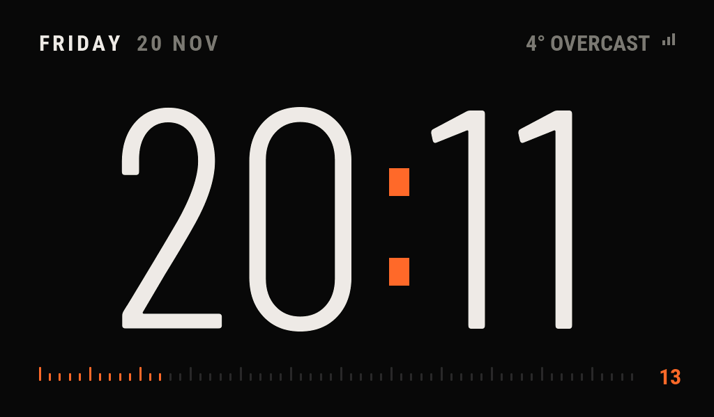

# ESP32-S3 Digital Clock

A clock for the verified 1024 x 600 RGB panel attached to an ESP32-S3-Touch-LCD
board. Large digital hours and minutes, a permanently orange colon, a growing
60-mark second scale, date, current weather and Wi-Fi signal. Changed hour
digits retain a 350 ms flip transition; minute digits switch immediately.



This is a deterministic capture of the actual LVGL UI, not a photograph.
The fixture shows November 20, 2026, 20:11:13 and simulated 4-degree overcast
weather. Production firmware gets weather over HTTPS and never imports fixtures.

## Hardware

The tested panel requires **1024 x 600**, despite the reported Touch-LCD-5
PCB marking. Select `waveshare-esp32-s3-touch-lcd-5b`; the earlier 800 x 480
mode produced vertical stripes. See [board evidence and timing](docs/board-reference.md).
Touch and RTC are unused. Every boot waits for NTP. Once synchronized, the
system clock continues running during a Wi-Fi outage.

## Build and configure

Pinned stack: Python 3.12, PlatformIO Core 6.1.18, espressif32 6.12.0,
ESP-IDF 5.5.0 and LVGL 8.3.11. Install uv and a C compiler for native tests.
Generated fonts are bundled; npm is needed only to regenerate them.

```sh
uv sync --frozen
cp clock.config.example.toml clock.config.toml
chmod 600 clock.config.toml
# Edit clock.config.toml with your Wi-Fi credentials.
make validate
make build
```

All application parameters live in that one TOML file. Validation runs before
build or upload. Values become immutable C constants; there is no settings
menu, remote configuration, NVS override or serial settings command.
A change requires rebuilding and uploading.

| Section | Parameters |
| --- | --- |
| Root | board: the verified 5B software profile |
| wifi | ssid, password; empty password supports an open network |
| time | ntp_servers: 1..3 hosts; sync_interval_seconds: 60..86400 |
| time | timezone: Europe/Kyiv, Etc/UTC or UTC; format: 24h or 12h |
| time | locale: ru_RU, uk_UA or en_US; controls weekday and month text |
| display | brightness: integer 0..100; no automatic screen timeout |
| weather | latitude: -90..90; longitude: -180..180 |
| weather | update_seconds: 60..86400; request_timeout_ms: 1000..60000 |
| weather | stale_after_seconds: 60..604800 |

Weather defaults to Kyiv, 50.45 / 30.523, matching the weather project's
source default. Weather descriptions are English. Requests run in a separate
task after Wi-Fi and NTP are ready. Expired or unavailable weather displays
dashes. Failed requests retain a previous reading only until its age limit.

Brightness 0 is off and 100 is continuously on. Intermediate values use software
PWM over the CH422G switch; actual flicker and duty cycle require a physical check.

## Upload

Build artifacts contain credentials. Never publish your private TOML,
generated headers, firmware images or flash dumps.

```sh
make ports
make deploy PORT=/dev/cu.usbmodem21211201
make monitor PORT=/dev/cu.usbmodem21211201
```

Replace the sample port with your device. deploy validates, builds and uploads;
build alone does not write the board. Logs distinguish Wi-Fi, NTP and weather
updates. The first valid time and all minute changes appear immediately;
subsequent hour-digit changes animate.

## Verification

```sh
make test
make lint
make preview
make verify-build
```

Build firmware first to install the pinned SDK and LVGL dependencies. If using
a custom PlatformIO package location, set CJSON_DIR to its
framework-espidf/components/json/cJSON directory for native weather tests.

Tests cover strict configuration and secret-safe errors, timezone rules,
network recovery, invalid weather responses and actual rendered pixels.
The renderer checks growing seconds, minute reset, constant colon, midnight,
both time formats and no redraw for identical clock values. verify-build
builds a clean source copy and confirms that a TOML change rebuilds its
consumer and the firmware image.

- [Waiting for NTP](docs/screenshots/clock-waiting.png)
- [Local midnight](docs/screenshots/clock-midnight.png)
- [Upper flip phase](docs/screenshots/flip-upper.png)
- [Lower flip phase](docs/screenshots/flip-lower.png)
- [Verification record](docs/verification.md)
- [UI geometry and fonts](docs/ui-design.md)
- [Startup and background tasks](docs/diagrams/clock-flow.md)
- [Digital face transitions](docs/diagrams/digital-face-flow.md)
- [Time service](docs/time-service.md)

## Source layout

- src/board.c: panel, I2C reset and backlight.
- src/network_time.c: background Wi-Fi reconnect and NTP.
- src/clock_ui.c and flip_digit.c: digital face and transitions.
- src/clock_weather*.c: HTTPS weather worker and bounded JSON parsing.
- tools/config.py and clockctl.py: validated deployment and private headers.
- tools/preview/: native rendering of the same UI code.
- tests/: configuration, network and weather checks.

## Credits

Weather data: [Open-Meteo](https://open-meteo.com/), under
[CC BY 4.0](https://creativecommons.org/licenses/by/4.0/).
The temperature is rounded model-derived data, not a local sensor reading.
[API documentation](https://open-meteo.com/en/docs).
Fonts: Barlow Condensed Light and Roboto Condensed, under SIL OFL;
license texts accompany the generated files in src/fonts/.
