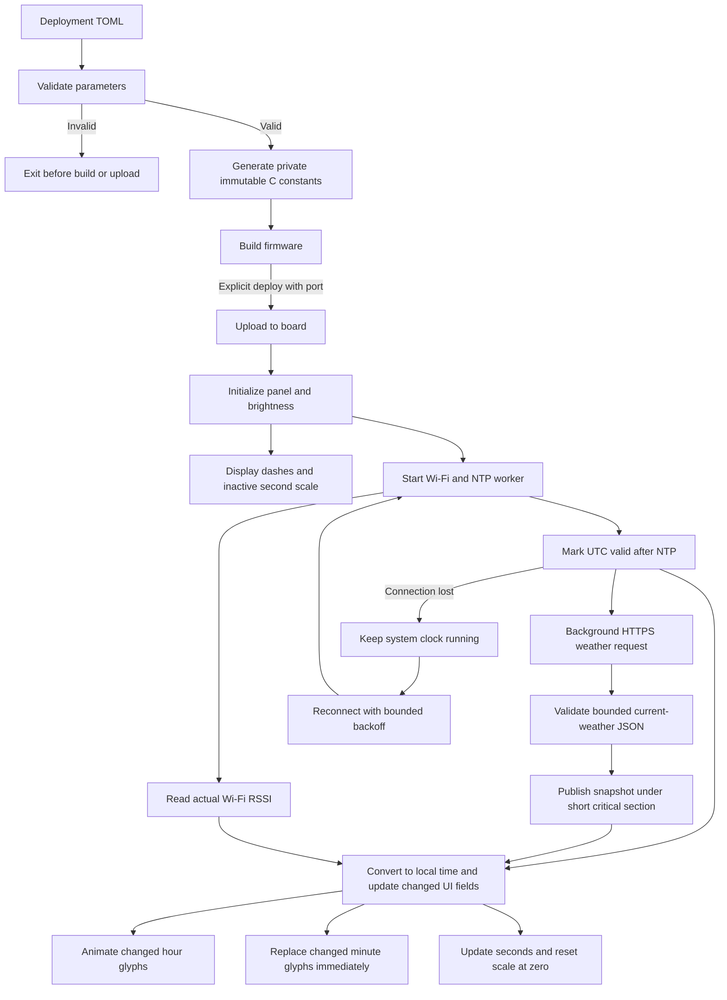
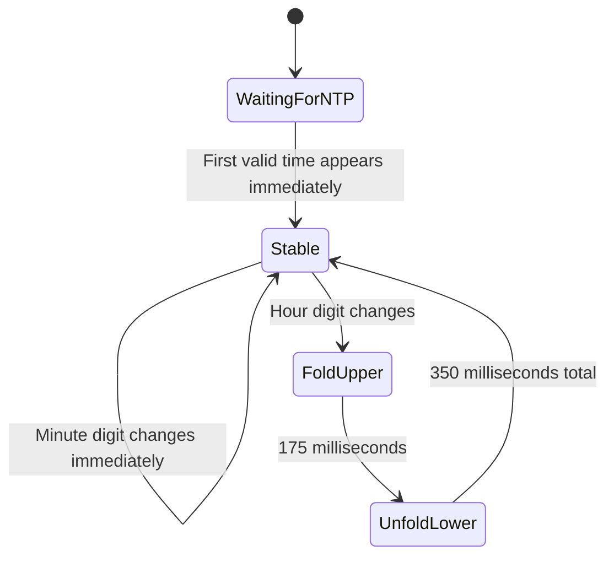

# Startup and background tasks

The verified software profile is 1024 x 600. RTC and touch are unused.
The face shows large HH:MM, a separate second counter and 60-mark scale.

A one-element overwrite queue delivers the latest Wi-Fi state to the network
worker, which owns reconnect attempts and SNTP restarts. Backoff grows from 1
to 60 seconds and resets after acquiring an IP. No network call runs in LVGL.
The weather task waits for Wi-Fi and NTP before TLS. It verifies the server
using the ESP certificate bundle, bounds responses to 4095 bytes and validates
temperature, integer WMO code and integer UTC timestamp. Failed requests keep
a previous reading only until its age limit. Unavailable weather shows dashes.
Weather is not persisted in NVS.

Brightness 0 and 100 use constant off/on output. For intermediate percentages,
a timer only notifies a dedicated task. That task writes the CH422G backlight
switch over I2C and arms the next phase. The UI colon has no blink timer.
