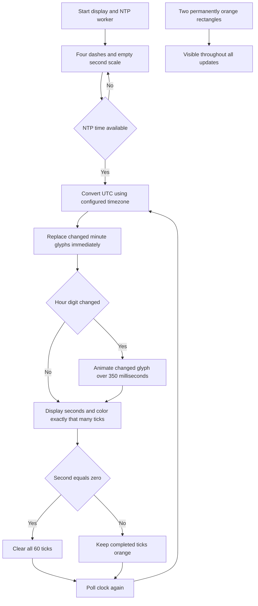

# Digital clock face

The date changes at local midnight. Identical clock values cause no redraw.
The native preview uses deterministic weather fixtures; it is not a photograph
of the device and does not measure its backlight brightness.
